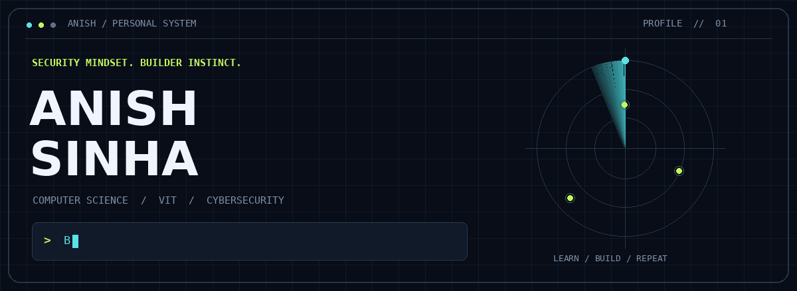
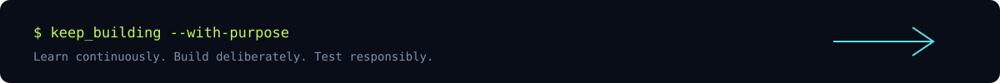

<!-- Upload this README and the complete assets folder to the root of the public anishsinha5280-source profile repository. -->

  <picture>
    <source media="(prefers-reduced-motion: reduce)" srcset="./assets/hero-static.png" />
    
  </picture>

  
  

  <a href="#01--the-person-behind-the-terminal">ABOUT</a> &nbsp; / &nbsp;
  <a href="#02--the-toolkit">TOOLKIT</a> &nbsp; / &nbsp;
  <a href="#03--selected-builds">BUILDS</a> &nbsp; / &nbsp;
  <a href="#04--inside-the-lab">LAB</a> &nbsp; / &nbsp;
  <a href="#05--commit-trail">ACTIVITY</a>

## 01 / The person behind the terminal

I’m a second-year**Computer Science and Engineering student at VIT**, specializing in **Cybersecurity**. I enjoy working across software development, networks, databases, and security research. I learn best by building practical projects, testing ideas in controlled environments, and documenting what works.

- **Core interests:** cybersecurity, network security, software engineering, and database systems
- **Currently exploring:** machine learning and reproducible evaluations of AI-assisted security tools
- **Community:** Junior Core Member at the **Whitehats Club**
- **Approach:** build it, test it, understand it, improve it

## 02 / The toolkit

| Area | Tools I work with |
| :--- | :--- |
| **Languages** | C · C++ · Python · Java · SQL · JavaScript · TypeScript |
| **Web development** | React |
| **Systems & security** | Linux · Wireshark |
| **Data & workflow** | Microsoft SQL Server · Git |

## 03 / Selected builds

<table>
<tr>
<td width="50%" valign="top">
<h3>01 &nbsp; Cyber-ROI</h3>

<strong>Vulnerability Risk Prioritization</strong>

Organizing vulnerability findings by risk so the most important issues can be addressed first.

<code>TypeScript</code>

<a href="https://github.com/anishsinha5280-source/Cyber-ROI-Vulnerability-Risk-Prioritization"><strong>Explore source →</strong></a>
</td>
<td width="50%" valign="top">
<h3>02 &nbsp; CampusPass</h3>

<strong>QR Event Ticketing System</strong>

Campus events, signed QR tickets by email, and gate check-ins with duplicate and capacity checks.

<code>Next.js</code> <code>React</code> <code>TypeScript</code> <code>PostgreSQL</code> <code>Drizzle ORM</code> <code>JWT</code> <code>QR scanning</code>

<a href="https://github.com/anishsinha5280-source/qr-ticketing-system"><strong>Explore source →</strong></a>
</td>
</tr>
<tr>
<td width="50%" valign="top">
<h3>03 &nbsp; Neon Rift</h3>

<strong>Wave Survival</strong>

A neon arena survival game with scaling waves, three enemy archetypes, object pooling, persistent settings and high scores. Includes desktop and browser versions.

<code>Godot 4</code> <code>GDScript</code> <code>React</code> <code>TypeScript</code> <code>Vite</code> <code>HTML Canvas</code>

<a href="https://github.com/anishsinha5280-source/neon_rift_survival_game"><strong>Explore source →</strong></a>
</td>
<td width="50%" valign="top">
<h3>04 &nbsp; EV Charging Engine</h3>

<strong>Intelligent EV Charging and Depot Management</strong>

Coordinating EV charging, fleet reservations, and depot/grid capacity through a relational schema and reservation workflows.

<code>Microsoft SQL Server</code> <code>SQL</code> <code>Stored Procedures</code> <code>Triggers</code>

<em>Repository not linked publicly here.</em>

</td>
</tr>
</table>

## 04 / Inside the lab

Learning through controlled experiments, practical builds, and research.

<b>Adaptive University Research Network</b> — Context-Aware Access Control

   
  A network-security project concept for connecting university labs, faculty, students, and servers using VLANs, routing, ACLs, and firewall rules, with access decisions informed by context.
    
  **Topics:** VLANs · IP addressing · Routing · ACLs · Firewalls · Wireshark
   

<b>AI-Assisted Security Evaluation</b> — Research in Progress

   
  Exploring reproducible ways to compare LLM-assisted agents on security tasks inside isolated, controlled web and network labs. The emphasis is on repeatable experiments, clear evaluation criteria, and responsible testing.
    
  **Focus:** LLM evaluation · Web security labs · Network testing · Reproducibility

<b>AI-Assisted OSINT, Privacy and Law</b> — Research in Progress

   
  Studying how AI-assisted collection and correlation of public online information can affect privacy, and how existing legal frameworks address the risks of persistent monitoring and profiling.
    
  **Focus:** OSINT · Privacy · Responsible data use · Legal and ethical analysis

## 05 / Commit trail

The repositories tell the story: ideas, iterations, and lessons along the way.

**[Browse repositories →](https://github.com/anishsinha5280-source?tab=repositories)** &nbsp; · &nbsp; **[View contribution history →](https://github.com/anishsinha5280-source)**

<strong>Open live GitHub statistics</strong>

 

  
  

 

